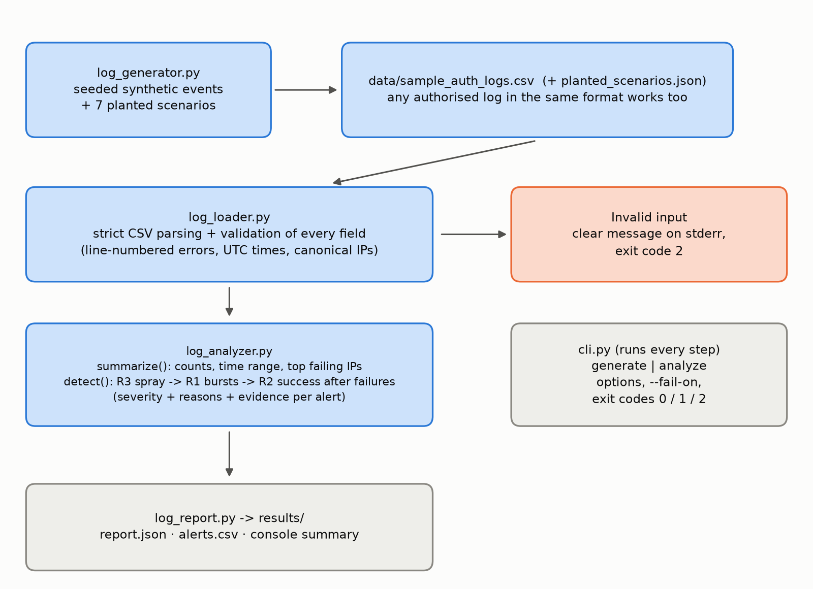
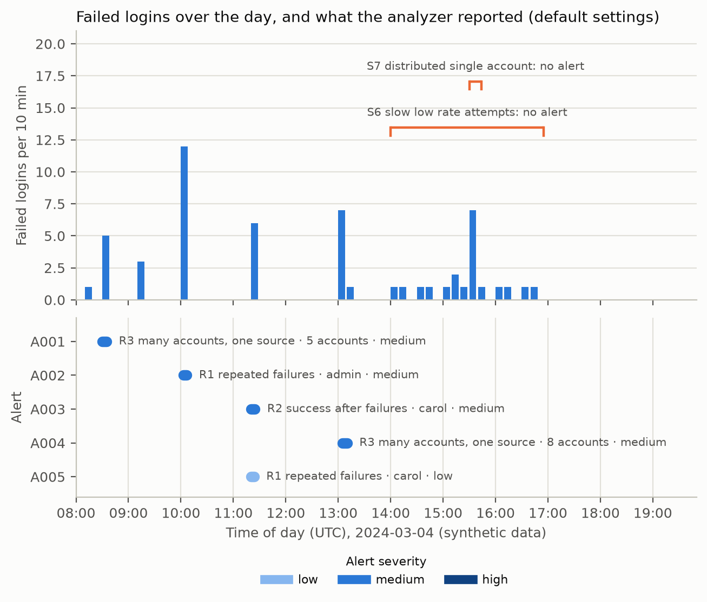
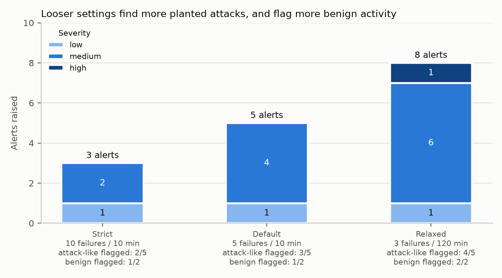

# 1. Title Page

**A Small Defensive Tool for Summarising Authentication Logs and Flagging Suspicious Patterns**
*Python authentication-log analyzer with explainable, evidence-backed alerts*

Cybersecurity Assessment, **Task 13: Build a Small Defensive Security Tool**

| | |
|---|---|
| Author | Sargun Kaur |
| Student / Applicant ID | Not applicable |
| Submission date | 29 October 2026 |
| Final results generated | 2026-10-29 (Python 3.14.7, Windows 11) |
| Repository | https://github.com/SargunKaur15/ai-cybersecurity-assessment |

---

# 2. Abstract / Executive Summary

This project is a command-line tool that reads authentication events from a CSV file, validates them, summarises them, and raises **explainable alerts** for three patterns that deserve a human look: repeated failed logins for one account from one source, a successful login shortly after such failures, and failed logins against many accounts from one source (a password-spraying-like pattern).

The tool was developed and tested on **synthetic data only**. A generated sample log of 119 events (34 successful and 55 failed logins, 18 users, 24 source addresses) contains a quiet baseline plus seven planted scenarios whose correct handling is known in advance. With the default settings (5 failures within 10 minutes) the tool produced **5 alerts**: it flagged the planted brute-force-like, success-after-failures and spray-like patterns, left a benign "fumble" alone, **missed two evasive scenarios by design** (a slow attack and a distributed attack), and raised **one false positive by design** (colleagues behind a shared office address during a login outage). A comparison of three threshold settings shows the trade-off: stricter settings raise fewer alerts and miss more of the planted attack-like scenarios, looser settings find more but also flag benign activity, and the distributed attack is missed by all three.

Every alert lists the exact source events, the reasons for its severity, and recommended next steps, and is worded as "requires investigation", never as a confirmed attack. The 105-test pytest suite passes. The tool is a learning prototype with fixed-threshold rules; it is not a substitute for a SIEM or for analyst judgement.

---

# 3. Problem Statement from the Assessment

> **Task 13. Build a Small Defensive Security Tool.** Create a simple tool for a benign task, such as checking password-policy compliance in synthetic data, validating a security checklist, or summarizing sample logs. Use a language you are comfortable with.
> **Expected deliverable:** Working prototype, sample output, and test cases.

The chosen benign task is **summarising sample logs**. Mapping to the deliverable: the **working prototype** is described in Sections 8 and 9, the **sample output** in Section 11, and the **test cases** in Sections 10 and 11.

---

# 4. Objectives

1. Generate synthetic authentication events with `timestamp, username, source_ip, event_type, status`.
2. Validate input and give clear, line-numbered errors, including for malformed and empty files.
3. Summarise total events, successful logins, failed logins, unique users and unique source IPs.
4. Detect repeated failed logins using a configurable threshold and time window.
5. Detect a successful login following repeated failures, where the available data supports that.
6. Assign explainable severity levels and attach evidence to every alert, without labelling every unusual event a confirmed attack.
7. Produce JSON and CSV reports through a command-line interface.
8. Provide unit tests and document assumptions, false positives, false negatives and why an alert does not prove an attack.
9. Keep the tool defensive and limited to synthetic or authorised logs.

---

# 5. Scope and Assumptions

**In scope:** one CSV file of authentication events; three rules; summaries; JSON/CSV/console output; a synthetic data generator.

**Out of scope:** live log collection, real-time monitoring, blocking or remediation, geolocation or IP reputation, per-user behavioural baselines, multi-source correlation, and any real system or real log.

**Assumptions**

- Timestamps are ISO 8601; values without an offset are treated as UTC. Rows may arrive in any order.
- Usernames are compared case-insensitively. Exact duplicate rows are kept, not removed.
- "Successful/failed logins" count only `event_type = login`. "Unique users/IPs" count all events.
- A source address and username that both match are what links events (the available fields support nothing stronger).
- Window comparisons are inclusive: events exactly W minutes apart are within the window.
- Default thresholds (N = 5 failures, W = 10 min, S = 10 min, M = 5 accounts) are illustrative starting points, not recommended production values.

---

# 6. Tools and Technologies

| Tool | Version | Purpose |
|---|---|---|
| Python | 3.14.7 | Language |
| pandas | 3.0.5 | Data handling and window logic |
| Python standard library | 3.14 | `csv` (strict row parsing), `ipaddress` (IP validation), `logging`, `datetime` (generator), `argparse` (CLI), `json` |
| Matplotlib | 3.11.1 | Report charts and the workflow diagram only (the analyzer itself does not need it) |
| pytest | 9.2.0 | Test suite |

Streamlit was not used. The dependency list (`requirements.txt`) is shared with Task 14.

---

# 7. Methodology

1. **Define the data model** and the validation rules (Section 9.1).
2. **Generate synthetic data** with a known answer key: a baseline of normal behaviour plus seven planted scenarios, including benign look-alikes and deliberate evasions, so that false positives and false negatives can be *demonstrated* rather than only asserted.
3. **Implement three rules** with explicit, documented thresholds, and a severity scheme whose every step is written into the alert.
4. **Test** with hand-built event sets that isolate one behaviour each (boundaries, edge cases, invalid input), with end-to-end tests against the planted scenarios, and with CLI tests.
5. **Verify the outputs** independently: summary counts were re-counted with `awk`, and tests were mutation-checked (Section 10).
6. **Compare settings** (strict, default, relaxed) on the same data to show the threshold trade-off.
7. **Record** actual outputs in `results/` and write this report from them.

---

# 8. System Architecture / Workflow



*Figure 1. Data flow of the tool (drawn from the code structure; generated by `src/make_log_figures.py`).*

---

# 9. Implementation Details

## 9.1 Input validation (`log_loader.py`)

The file is read with Python's `csv` module so every row's field count is checked and true line numbers are kept (pandas' own reader silently drops surplus fields, which was found during testing, see Section 11.7). Rejected with a clear message: missing file, zero-byte file, missing columns, rows with the wrong number of fields, invalid timestamps, empty usernames, invalid IP addresses, unknown event types or statuses, and non-UTF-8 input. Error values are escaped and truncated before being echoed, and at most 20 problems are listed. A header-only file is valid and yields an empty dataset. Column names and values are normalised (case, whitespace); IPv6 addresses are canonicalised.

## 9.2 Detection logic (`log_analyzer.py`)

Only `login` events are used. Each rule uses a two-pointer sliding window over time-sorted events.

| Rule | Condition | Notes |
|---|---|---|
| **R1** repeated failed logins | at least **N** failures for the same (username, source IP) within **W** minutes | Overlapping windows are merged, so one sustained attack gives **one** alert with the full count. Separate bursts give separate alerts. |
| **R2** success after repeated failures | a success for the same (username, source IP) strictly after the last failure of an R1 burst and within **S** minutes | A success from another address or account is *not* linked. |
| **R3** multi-account failures from one source | at least **M** distinct usernames with failures from one IP within **W** minutes | Later successes for the targeted accounts are listed in the alert as a note. |

All thresholds and windows are configurable (`AnalyzerConfig` and CLI options) and validated: counts must be integers of at least 2 and windows finite numbers above 0.

## 9.3 Severity scheme

Severity is computed in steps, and each step is recorded in the alert's `severity_reasons`.

| Rule | Base | Raised when | Maximum |
|---|---|---|---|
| R1 | low | failures ≥ 2N → medium; the same IP also triggers R3 → +1 level | high |
| R2 | medium | failures ≥ 2N → high; the same IP also triggers R3 → +1 level | high |
| R3 | medium | accounts ≥ 2M → high | high |

Rationale: a handful of failures is common (typos), so R1 starts low. A success after repeated failures is the observation that most needs a look, so R2 starts at medium. Many accounts from one source is a recognised pattern but also occurs with shared gateways, so R3 starts at medium. Volume and corroboration raise the level. There is deliberately **no "critical" level**, because nothing in this data can confirm a compromise. For R3, later successes do **not** raise severity: they occur in benign cases too (scenario S5 below), so they are surfaced as a note for the analyst instead.

## 9.4 Evidence and wording

Each alert contains: rule, severity, the affected usernames and source IP, first and last time seen, the exact event count, up to 50 evidence rows (each with its original CSV line number; the final row is always kept and `evidence_omitted` gives the shortfall), the severity reasons, recommended investigation steps, and a fixed disposition: *"Requires investigation; not a confirmed incident."* Descriptions state the pattern, name an innocent explanation, and avoid the words "confirmed" or "compromised" as a conclusion.

**Why an alert does not prove an attack:** every rule describes a *pattern*, and each pattern has ordinary explanations (a mistyped or forgotten password, a stale saved credential, a shared office address, a login outage, an organisation's own scanner). The data contains no information about intent, so the strongest honest statement is "this warrants a look".

## 9.5 Output and CLI (`log_report.py`, `cli.py`)

`generate` writes the synthetic log and a scenario manifest; `analyze` writes `report.json` and `alerts.csv` and prints a summary. Reports carry no generation timestamp, so identical input gives byte-identical output. Text from logs is neutralised in the CSV (a leading `=`, `+`, `-` or `@` gets a `'` prefix) to prevent spreadsheet formula injection [8]. Exit codes: 0 success, 1 `--fail-on` triggered, 2 invalid input or options. Progress is logged with the standard `logging` module (`-v`).

## 9.6 Synthetic data (`log_generator.py`)

Seeded generation (seed 42, fixed date 2024-03-04). Source addresses use only the RFC 5737 documentation ranges [5]. The baseline has 17 users logging in and out during working hours, a few single typos and MFA events, and one password reset. Seven scenarios are added; the manifest (`data/planted_scenarios.json`) records for each whether it is benign and what the default configuration is expected to report:

| ID | Planted behaviour | Intended default result |
|---|---|---|
| S1 | `dana`: 3 failures then success within ~100 s (benign fumble) | no alert |
| S2 | `admin`: 12 failures in ~4 min from one IP, no success | R1 medium |
| S3 | `carol`: 6 failures, then a success 60 s later, same IP | R1 low + R2 medium |
| S4 | 8 accounts fail once each from one IP; `frank` later succeeds | R3 medium |
| S5 | 5 colleagues behind a shared office IP fail once each, then succeed (benign outage) | R3 medium (**false positive**) |
| S6 | `grace`: 12 failures, one per 15 min | no alert (**miss**) |
| S7 | `heidi`: 6 failures from 6 different IPs, then a success from a 7th | no alert (**miss**) |

## 9.7 Figures (`make_log_figures.py`)

Draws the alert timeline, the settings comparison and the workflow diagram from the real log, `report.json` and the manifest, and writes `results/settings_comparison.csv` by running the analyzer under three settings.

---

# 10. Testing Methodology

`python -m pytest tests -v`: **105 tests** in five files.

| File | Tests | Focus |
|---|---:|---|
| `test_log_loader.py` | 25 | Valid files, normalisation (case, spaces, BOM, IPv6, time zones), each invalid field with its line number, wrong field counts, blank lines, quoted commas, non-UTF-8, empty / zero-byte / missing / header-only files, error truncation |
| `test_log_analyzer.py` | 48 | Hand-counted summary; empty dataset; normal events; below-threshold; exact threshold and **window boundaries** (inclusive); different IPs/users not combined; merged and separate bursts; unsorted input; severity levels and reasons; R2 boundaries and non-links; R3 thresholds and windows; evidence integrity and capping; wording; determinism; configuration validation |
| `test_log_generator.py` | 9 | Seed reproducibility, loader compatibility, RFC 5737 addresses only, committed sample equals generator output, **default config reports exactly the planted alerts**, benign and missed scenarios stay quiet, missed scenarios depend on configuration, benign flags, manifest matches generator |
| `test_log_cli.py` | 20 | End-to-end `analyze`, output formats, options, empty dataset, error exit codes, `--fail-on`, `generate` round trip, CSV formula-injection protection |
| `test_log_figures.py` | 3 | Figures are valid PNGs, settings table matches the CLI run, missing input gives a clear error |

**Do the tests have teeth?** On a scratch copy of the analyzer, four deliberate bugs were introduced one at a time: (1) the burst window made exclusive instead of inclusive, (2) the success window made exclusive, (3) the R1 "twice the threshold" severity raise disabled, (4) R3 counting events instead of distinct users. Each caused test failures (1, 1, 3 and 13 failing tests respectively), while the unmutated control passed all 105. This shows the tests detect these specific faults, not that they would catch every possible fault.

**Independent check of the summary:** the five summary counts were re-computed with `awk` directly from the CSV and matched the tool.

---

# 11. Actual Test Results

All results below come from the files in `results/`, produced on 2026-10-29.

## 11.1 Unit tests

**105 passed in 6.30 s** on Python 3.14.7 / Windows 11 (`results/pytest_output.txt`).

## 11.2 Example command and summary

```
$ python src/cli.py analyze --input data/sample_auth_logs.csv
Authentication log summary: sample_auth_logs.csv
  Total events:        119
  Successful logins:   34
  Failed logins:       55
  Unique users:        18
  Unique source IPs:   24
  Time range (UTC):    2024-03-04T08:13:39Z -> 2024-03-04T17:26:47Z
```

The 119 events are 89 `login` (34 success, 55 failure), 25 `logout`, 4 `mfa_challenge` and 1 `password_reset`. Re-counted with `awk`: 119 / 34 / 55 / 18 / 24. The match confirms the summary logic; it does not validate anything about real-world data.

## 11.3 Sample findings (default settings)

| ID | Severity | Rule | Account(s) | Source IP | Events | First seen (UTC) |
|---|---|---|---|---|---:|---|
| A001 | medium | MULTI_ACCOUNT_FAILURES_FROM_SOURCE | 5 accounts (nina, omar, pat, quinn, ravi) | 192.0.2.10 | 5 | 08:30:00 |
| A002 | medium | REPEATED_FAILED_LOGINS | admin | 203.0.113.50 | 12 | 10:03:00 |
| A003 | medium | SUCCESS_AFTER_REPEATED_FAILURES | carol | 203.0.113.23 | 7 | 11:20:00 |
| A004 | medium | MULTI_ACCOUNT_FAILURES_FROM_SOURCE | 8 accounts | 203.0.113.77 | 8 | 13:05:00 |
| A005 | low | REPEATED_FAILED_LOGINS | carol | 203.0.113.23 | 6 | 11:20:00 |

Counts: 5 alerts (0 high, 4 medium, 1 low). The full evidence, severity reasons and recommended steps for each are in `results/report.json`; a flattened view is in `results/alerts.csv`.



*Figure 2. Failed logins per 10 minutes (top) and the alerts raised (bottom, coloured by severity). The orange brackets mark attack-like planted scenarios (S6, S7) that raised no alert with default settings.*

**Reading the alerts**

- **A002** (`admin`): 12 failures within about 4 minutes. Base severity low (≥ 5 failures), raised to medium because 12 ≥ 2 × 5. No success follows in the data. *What can be concluded:* a burst of failures against a privileged-sounding account from one address. *What cannot:* whether it is an attack, a scanner, or a broken client.
- **A005 + A003** (`carol`): 6 failures (low), then a success 60 seconds after the last failure from the same address (medium). Both are reported because they are different observations; A003 is the one to prioritise. *Cannot conclude:* whether the password was guessed or the legitimate owner remembered it. The recommended first step is to confirm with the owner through a separate channel.
- **A004**: one failure each for 8 accounts within about 6 minutes from one address. No single account reaches the R1 threshold, so only R3 sees it. The alert notes that `frank` had a later success from the same address, but severity stays medium.
- **A001** is a **false positive by construction** (S5). Five colleagues behind a shared office address each failed once during a simulated outage and then succeeded. The tool cannot distinguish this from a spray and correctly labels it as requiring investigation only; the alert text names shared gateways and outages as explanations, and notes that 5 of the 5 accounts later succeeded from that address.

## 11.4 Planted scenarios versus results

| Scenario | Expected | Actual (default) | Outcome |
|---|---|---|---|
| S1 benign fumble | none | none | correct |
| S2 repeated failures | R1 medium | A002 | detected |
| S3 success after failures | R1 low + R2 medium | A005 + A003 | detected |
| S4 spray pattern | R3 medium | A004 | detected |
| S5 shared NAT | R3 medium (false positive) | A001 | false positive, as designed |
| S6 slow attempts | none (miss) | none | missed, as designed |
| S7 distributed account attack | none (miss) | none | missed, as designed |

This is a check against synthetic scenarios written together with the rules, so agreement is expected. It shows the code does what it was designed to do, not that the design catches real attacks.

## 11.5 Effect of the settings

`results/settings_comparison.csv` is produced by running the analyzer on the same log under three settings (spray threshold fixed at 5 accounts):

| Setting | Failures / window | Alerts (low / medium / high) | Attack-like scenarios flagged (of 5) | Benign scenarios flagged (of 2) |
|---|---|---|---|---|
| Strict | 10 / 10 min | 3 (1 / 2 / 0) | 2: S2, S4 | 1: S5 |
| Default | 5 / 10 min | 5 (1 / 4 / 0) | 3: S2, S3, S4 | 1: S5 |
| Relaxed | 3 / 120 min | 8 (1 / 6 / 1) | 4: S2, S3, S4, S6 | 2: S1, S5 |



*Figure 3. Alerts by severity under three settings, with how many planted attack-like and benign scenarios each flagged (counted when an alert involves one of the scenario's accounts).*

Relaxing the settings catches the slow attack (S6) but also flags the benign fumble (S1) and raises carol's success-after-failures to high (`results/example_custom_thresholds_output.txt`). **No setting catches S7** (the distributed attack), because R1 groups by account *and* address. Lower thresholds find more but add noise, which is the central tuning trade-off.

## 11.6 Invalid input example (`results/example_invalid_input_output.txt`)

```
$ python src/cli.py analyze --input bad_input.csv   (deliberately malformed synthetic file)
error: Invalid input (1 problem(s)):
line 4: expected 5 field(s), found 4
exit code: 2
```

Row-shape problems are reported first. Field-level problems (bad timestamp, IP, status) are reported together once every row has the right shape.

## 11.7 Defects found and fixed during testing

- **Malformed rows were mishandled.** The first version read the file with `pandas.read_csv`. A test with a row containing extra fields crashed with an unhelpful `TypeError` (pandas had inferred a multi-index), and a deeper check showed that another pandas option would silently drop the surplus fields. The loader was rewritten to use the `csv` module with explicit field-count checks, and tests were added for wrong field counts, blank lines and true line numbers.

---

# 12. Screenshots

The screenshots below were captured from real console windows that ran the commands shown; the command line and its output are exactly what the program printed, and nothing was edited. The same console output is saved in `results/` and reproduced verbatim after the screenshots. Run times in the pytest summaries differ slightly between runs.


*Screenshot 1. `python src/cli.py generate` writes 119 synthetic events and the planted-scenario manifest.*


*Screenshot 2. `python src/cli.py analyze --input data/sample_auth_logs.csv` prints the summary and the 5 alerts.*


*Screenshot 3. Invalid input handling: a deliberately malformed CSV (a temporary file, deleted afterwards) is rejected with `line 4: expected 5 field(s), found 4` and exit code 2.*


*Screenshot 4. `python -m pytest tests -q` for Task 13: 105 passed.*


**Console output of the analysis run (`results/cli_analyze_output.txt`):**

```
$ python src/cli.py analyze --input data/sample_auth_logs.csv
Authentication log summary: sample_auth_logs.csv
  Total events:        119
  Successful logins:   34
  Failed logins:       55
  Unique users:        18
  Unique source IPs:   24
  Time range (UTC):    2024-03-04T08:13:39Z -> 2024-03-04T17:26:47Z

Alerts: 5 (high 0, medium 4, low 1)
  [A001] MEDIUM MULTI_ACCOUNT_FAILURES_FROM_SOURCE  user=5 accounts  src=192.0.2.10  events=5  2024-03-04T08:30:00Z
  [A002] MEDIUM REPEATED_FAILED_LOGINS  user=admin  src=203.0.113.50  events=12  2024-03-04T10:03:00Z
  [A003] MEDIUM SUCCESS_AFTER_REPEATED_FAILURES  user=carol  src=203.0.113.23  events=7  2024-03-04T11:20:00Z
  [A004] MEDIUM MULTI_ACCOUNT_FAILURES_FROM_SOURCE  user=8 accounts  src=203.0.113.77  events=8  2024-03-04T13:05:00Z
  [A005] LOW    REPEATED_FAILED_LOGINS  user=carol  src=203.0.113.23  events=6  2024-03-04T11:20:00Z

Alerts mark patterns that warrant investigation. They are not confirmed incidents, and the absence of an alert
does not mean the activity is safe. Intended for synthetic or authorised logs only.
Wrote results\report.json
Wrote results\alerts.csv
exit code: 0
```

---

# 13. Discussion and Limitations

## 13.1 Recommended investigation steps

These are included in each alert and summarised here.

1. **Verify with the owner** through a separate, trusted channel (not by replying to the suspicious activity) whether the account owner recognised the logins.
2. **Check account state:** lockout, MFA and recent password-reset history.
3. **Pivot on the source address:** what else did it do in the same period, and is it a known gateway, VPN or office address?
4. **For multi-account patterns,** look for a service outage or recent single-sign-on change, then review the targeted accounts, starting with any that later succeeded.
5. **After a success following failures,** review what the session did, using authorised audit logs.
6. **Escalate** under your organisation's incident process only if the evidence supports it. Take any blocking or credential reset through that process, not from this tool.

## 13.2 False positives

Mistyped passwords, stale saved passwords and mobile or email clients retrying (R1, R2); a user who fails several times and then remembers the password (R2); shared NAT, VPN or proxy addresses, and login outages (R3, shown by S5); vulnerability scanners and monitoring checks run by the organisation itself.

## 13.3 False negatives

- **Low-and-slow attempts** below the per-window threshold (S6), unless the window is widened.
- **Distributed attempts** against one account from many addresses (S7), because R1 groups by username *and* address. No tested setting catches it.
- A **success from a different address** than the failures is not linked.
- Spraying with fewer than M accounts, or spread across windows.
- Attacks using credentials that were already valid, or events that are not logged or not in this file.
- Attempts hidden by incorrect or missing log timestamps.

## 13.4 Other limitations and assumptions

Fixed thresholds with no per-user or per-environment baseline; no geolocation, device or reputation context; no lockout awareness; no deduplication of duplicate rows; the whole file is read into memory; one file at a time. The severity levels are heuristics and are not calibrated against real incidents. The sample data is small (119 events) and was written alongside the rules, so the results show the logic working as designed rather than its effectiveness against real attackers. Real logs bring noisy formats, missing fields, clock skew and volume.

## 13.5 Possible improvements (not implemented)

Per-account detection across all source addresses (would address S7); allow-lists for known shared addresses (would address S5); user baselines (usual location and hours); streaming for large files; additional rules such as impossible travel; lockout state awareness; and rule tuning against authorised real data.

---

# 14. Ethical and Security Considerations

- **Defensive and bounded.** The tool only reads a local CSV and writes reports. It contacts no hosts, blocks nothing, and changes no accounts.
- **Synthetic data only.** No real credentials, personal data or confidential logs were used. Usernames are invented, and all IP addresses come from the ranges reserved for documentation (RFC 5737) [5], which a unit test enforces. Use the tool only on logs you are authorised to analyse.
- **Avoiding over-claiming.** Alerts are leads: they carry a fixed "not a confirmed incident" disposition, describe innocent explanations, and avoid labels such as "attack" or "compromised" as conclusions. The absence of an alert is also stated not to mean safety.
- **Safe handling of untrusted log content.** Log fields can be attacker-controlled. Error messages escape and truncate them, and CSV output neutralises leading formula characters to prevent spreadsheet formula injection [8].
- **Privacy.** In real use, authentication logs contain personal data (usernames, addresses). Reports should be stored and shared according to the organisation's data-handling rules.
- **Responsible action.** Blocking addresses or resetting credentials on the basis of these alerts alone could harm legitimate users (see S5). Recommended steps emphasise verification first.

---

# 15. Conclusion

The tool meets the stated task: it summarises synthetic authentication logs, flags repeated failures, a success after repeated failures and multi-account failures using configurable thresholds, assigns explainable severities, attaches evidence to every alert, and writes JSON and CSV reports through a CLI. On the generated sample it produced 5 alerts, all matching the planted scenarios it was designed to detect, while a benign fumble stayed quiet, a benign outage produced a deliberate false positive, and a slow and a distributed attack were deliberately missed. All 105 tests pass, the summary counts were independently re-counted, and four deliberate bugs were caught by the test suite.

The main lessons are about trade-offs rather than detection power: any fixed threshold either misses patterns that stay below it or buries analysts in benign alerts (Section 11.5), and the rules can be evaded by simply spreading activity over time or addresses. The tool is a prototype for learning and triage support on synthetic or authorised logs. It is not a replacement for a SIEM, and it needs real data and tuning before any operational use.

---

# 16. References

All links were opened and confirmed to load when this report was prepared.

1. Python Software Foundation. *csv: CSV File Reading and Writing.* https://docs.python.org/3/library/csv.html
2. Python Software Foundation. *ipaddress: IPv4/IPv6 manipulation library.* https://docs.python.org/3/library/ipaddress.html
3. Python Software Foundation. *logging: Logging facility for Python.* https://docs.python.org/3/library/logging.html
4. Python Software Foundation. *datetime: Basic date and time types*; *argparse: Parser for command-line options, arguments and subcommands.* https://docs.python.org/3/library/datetime.html and https://docs.python.org/3/library/argparse.html
5. IETF. *RFC 5737: IPv4 Address Blocks Reserved for Documentation.* https://www.rfc-editor.org/rfc/rfc5737
6. pandas development team. *pandas documentation.* https://pandas.pydata.org/docs/
7. pytest documentation. https://docs.pytest.org/en/stable/
8. OWASP Foundation. *CSV Injection.* https://community.owasp.org/attacks/CSV_Injection
9. MITRE. *ATT&CK: Brute Force (T1110)*, including sub-techniques Password Guessing (T1110.001), Password Spraying (T1110.003) and Credential Stuffing (T1110.004). https://attack.mitre.org/techniques/T1110/ and https://attack.mitre.org/techniques/T1110/003/
10. NIST. *SP 800-92: Guide to Computer Security Log Management* (September 2006). https://csrc.nist.gov/pubs/sp/800/92/final
11. OWASP Foundation. *Authentication Cheat Sheet* (login throttling, account lockout, logging and monitoring). https://cheatsheetseries.owasp.org/cheatsheets/Authentication_Cheat_Sheet.html
12. Matplotlib development team. *Matplotlib documentation.* https://matplotlib.org/stable/

---

# 17. Appendix: Files and Reproduction Steps

## A. Files

| Path | Purpose |
|---|---|
| `data/sample_auth_logs.csv` | 119 synthetic events (generated, seed 42) |
| `data/planted_scenarios.json` | The seven planted scenarios, their benign flags and expected default alerts |
| `src/log_loader.py` | Strict CSV loading and validation |
| `src/log_generator.py` | Seeded synthetic events with planted scenarios |
| `src/log_analyzer.py` | Summary, three detection rules, severity logic |
| `src/log_report.py` | JSON / CSV / console output |
| `src/cli.py` | `generate` and `analyze` commands |
| `src/make_log_figures.py` | Charts, workflow diagram and `settings_comparison.csv` |
| `tests/` | 105 pytest tests (five files plus helpers) |
| `results/report.json`, `results/alerts.csv` | The alert report for the sample log |
| `results/settings_comparison.csv`, `results/figures/*.png` | Settings comparison and report figures |
| `results/cli_*_output.txt`, `example_*_output.txt`, `pytest_output.txt` | Captured console output |

## B. Reproduction steps

Recorded results used Python 3.14.7 on Windows 11. From the repository root:

```
python -m venv .venv
.venv\Scripts\Activate.ps1          (Windows PowerShell; on macOS/Linux: source .venv/bin/activate)
python -m pip install -r requirements.txt
cd task-13-security-log-analyzer
python src/cli.py generate
python src/cli.py analyze --input data/sample_auth_logs.csv
python src/make_log_figures.py
python src/cli.py analyze --input data/sample_auth_logs.csv --failure-threshold 3 --window-minutes 120 --format json --output-dir <any folder>
python -m pytest tests -q
```

Reports contain no generation timestamp, so re-running on the same input gives a byte-identical `report.json`.
