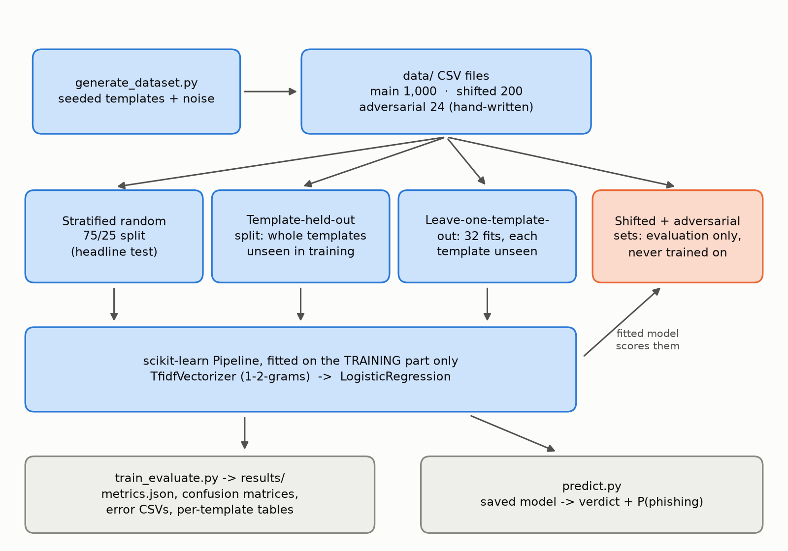
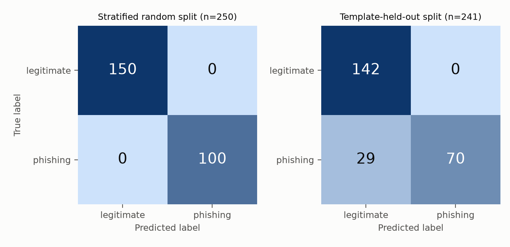
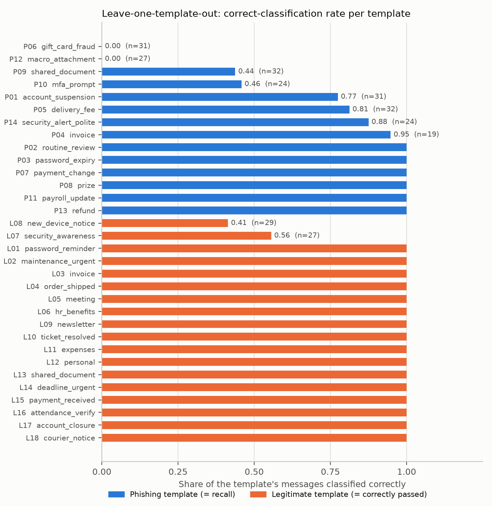
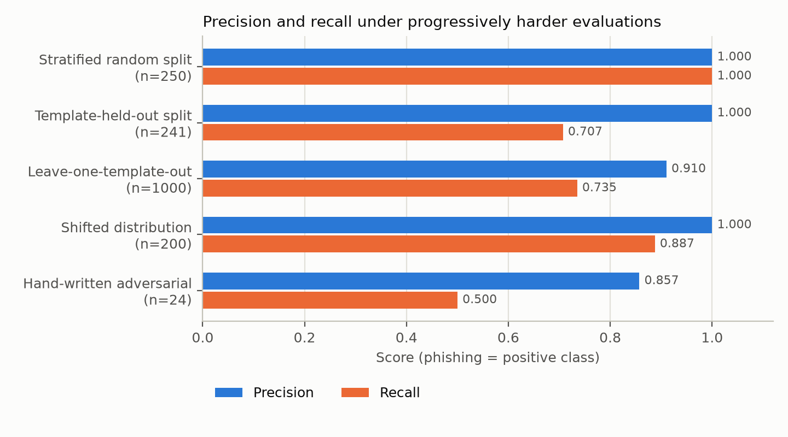

# 1. Title Page

**Evaluating the Claim That AI Can Identify Phishing Messages**
*A small synthetic-data experiment with TF-IDF and Logistic Regression*

Cybersecurity Assessment, **Task 14: Evaluate an AI Security Claim**

| | |
|---|---|
| Author | Sargun Kaur |
| Student / Applicant ID | Not applicable |
| Submission date | 29 October 2026 |
| Final results generated | 2026-10-29 (Python 3.14.7, Windows 11) |
| Repository | https://github.com/SargunKaur15/ai-cybersecurity-assessment |

---

# 2. Abstract / Executive Summary

The claim investigated is that *artificial intelligence can identify phishing messages*. Real phishing data was deliberately not used. Instead, a reproducible synthetic dataset of 1,000 phishing-like and legitimate workplace messages (40% phishing) was generated from 32 message templates, and a small scikit-learn pipeline (TF-IDF, then Logistic Regression) was trained and evaluated under progressively harder conditions.

On a conventional stratified 75/25 split the model made **no errors** (accuracy, precision, recall and F1 all 1.0000 on 250 test messages). This is **not** evidence that the model detects real phishing: every template appears in both the training and test halves, so the test messages are near-duplicates of training messages, and the model's strongest features include artifacts of the generator itself (for example the tokens `http`, `test` and `invalid`).

A **stronger test that holds out entire message templates** gives a very different result:

- With 8 of the 32 templates held out of training (241 test messages), accuracy fell to **0.8797** and recall to **0.7071** (29 false negatives).
- With **leave-one-template-out** evaluation (every message scored by a model that never saw its template; n = 1,000), accuracy was **0.8650**, precision **0.9102** and recall **0.7350**, with 29 false positives and 106 false negatives.
- Two link-free templates (a gift-card request and a macro-attachment lure) were **never** detected when held out (0% recall), and two legitimate security-notice templates were flagged about half the time.

Two further evaluations, never used for training or tuning, agree: recall was **0.8875** on a shifted set of 200 messages from different templates, and recall was **0.5000** (accuracy 0.7083) on 24 hand-written adversarial probes.

The experiment supports a narrow conclusion: a bag-of-words model learns the surface patterns of the phishing it was trained on, and its measured accuracy depends heavily on how the test data relates to the training data. It does not validate the general claim and it is **not production-ready or suitable as a standalone security control**.

---

# 3. Problem Statement from the Assessment

> **Task 14. Evaluate an AI Security Claim.** Investigate a claim about AI and cybersecurity, such as AI-based phishing detection. Design a small experiment using synthetic examples, assess limitations, and explain where the approach may fail.
> **Expected deliverable:** Experiment plan, results, and limitations.

How this report maps to the deliverable: the **experiment plan** is Section 7, the **results** are Section 11, and the **limitations** are Section 13.

---

# 4. Objectives

1. State the claim as a testable hypothesis and design a small experiment around it.
2. Build a reproducible synthetic dataset with varied wording and deliberate class overlap.
3. Train a TF-IDF + Logistic Regression classifier inside a scikit-learn `Pipeline`, splitting before fitting to avoid data leakage.
4. Evaluate with accuracy, precision, recall, F1 and a confusion matrix, reporting sample counts and class distribution.
5. Go beyond a random split: hold out entire message templates, so the test set is not made of near-duplicates of the training set.
6. Examine false positives and false negatives and explain their practical security impact.
7. Probe where the approach fails: distribution shift, adversarial wording, and reliance on synthetic artifacts.
8. Provide a prediction script, tests, saved outputs and reproduction instructions.

---

# 5. Scope and Assumptions

**In scope:** text-only classification of short synthetic messages; one model family; a random split, template-held-out evaluations, and two further out-of-distribution probes.

**Out of scope:** real email or SMS corpora, HTML and attachments, headers and SPF/DKIM/DMARC results, URL or domain reputation, user behaviour, deep-learning or large-language-model detectors, and any live system.

**Assumptions**

- "Phishing-like" is defined by the generator's templates, which are modelled on commonly described phishing themes (account suspension, fake invoices, delivery fees, gift-card and payment-change requests, shared-document lures, MFA prompts). They are the author's approximation, informed by general descriptions of phishing and social engineering such as CISA's guidance [13], and not a measured sample of real attacks.
- Phishing is the **positive class**; the decision threshold is 0.5.
- Hyperparameters were fixed before any evaluation and not tuned.
- All names, amounts, ticket numbers and URLs are fabricated. URLs use only reserved domains (RFC 2606): `example.com/.net/.org`, `.test`, `.invalid`.

---

# 6. Tools and Technologies

| Tool | Version used | Purpose |
|---|---|---|
| Python | 3.14.7 | Language |
| pandas | 3.0.5 | Data handling, CSV I/O |
| NumPy | 2.5.2 | Numeric support |
| scikit-learn | 1.9.0 | `TfidfVectorizer`, `LogisticRegression`, `Pipeline`, metrics, split |
| Matplotlib | 3.11.1 | Confusion matrices, charts and the workflow diagram |
| pytest | 9.2.0 | Test suite [15] |

Versions are pinned in `requirements.txt` and recorded in `results/metrics.json`.

---

# 7. Methodology

## 7.1 Claim and hypothesis

*Claim:* "AI can identify phishing messages."

This is too broad to test directly, so it is reduced to hypotheses that a synthetic experiment *can* address:

- **H1:** A TF-IDF + Logistic Regression model can separate phishing-like from legitimate messages when test data comes from the same generator as the training data.
- **H2:** That performance is **not** a reliable indicator of performance when the test messages do not resemble training messages, whether because whole templates are unseen, the channel and topics change, or the wording is adversarial.

H1 is expected to hold trivially for template data, so H2 is the substantive test. The experiment can show *how the model behaves on synthetic data*, but it cannot confirm or refute the claim for real-world phishing.

## 7.2 Experiment plan

| Step | Action | Success / evidence criterion |
|---|---|---|
| 1 | Generate 1,000 main messages (32 templates) and 200 shifted messages with fixed seeds | Deterministic output (unit-tested) |
| 2 | Stratified 75/25 split **before** any fitting | Disjoint, stratified splits (unit-tested) |
| 3 | Fit the pipeline on the training split only | Vocabulary excludes test-only terms (unit-tested) |
| 4 | Evaluate on the held-out split and a majority-class baseline | Metrics beat baseline; counts reported |
| 5 | Remove URLs from test text and re-score | Check dependence on URL tokens |
| 6 | **Hold out whole templates** (8 of 32) and re-fit | No test message shares a template with training (unit-tested) |
| 7 | **Leave-one-template-out**: 32 fits, each scoring the one unseen template | Every message scored by a model that never saw its template (unit-tested) |
| 8 | Score the shifted set (different templates, channel and topics) | Measure the in-distribution to shifted gap |
| 9 | Score 24 hand-written adversarial probes | Identify failure modes |
| 10 | Inspect errors and strongest features | Explain *why* it succeeds or fails |

## 7.3 Dataset design

Each message is rendered from a template with randomly filled slots (names, services, amounts, dates, greetings, sign-offs, URLs). Design choices intended to make the task non-trivial:

- **14 phishing templates and 18 legitimate templates.**
- **Deliberate overlap:** legitimate messages include urgent wording ("URGENT: scheduled maintenance"), password and verification language, invoices, links and security-awareness text. Some phishing templates are polite and calm, and some contain no link (gift-card request, payment-detail change, macro attachment).
- **Shared surface noise** applied identically to both classes: 15% lower-cased, 10% trailing full stop dropped, 10% prefixed "FW:".
- **Uniqueness:** exact duplicate texts are rejected.

The **shifted set** (8 phishing and 8 legitimate templates) changes the channel and topics (bank card blocked, crypto, tax refund, toll fee, family emergency, one-time codes, appointment reminders, and so on). The **adversarial set** is 24 hand-written messages (12 phishing, 12 legitimate) that try to evade or imitate the obvious cues: link-free requests, character obfuscation, a non-English message, benign padding, and legitimate messages that use urgent or security-sounding wording.

## 7.4 Train/test separation

`train_test_split(test_size=0.25, stratify=label, random_state=42)` is called first. The pipeline is then fitted with `.fit()` on training texts only. The TF-IDF vocabulary and IDF weights are therefore learned from training data alone and applied unchanged to test data. This follows the scikit-learn guidance to split before any preprocessing and to use a `Pipeline` to avoid data leakage [3].

**Important caveat:** this prevents *procedural* leakage. It does not remove *structural* leakage: every template appears in both splits, so test messages are near-duplicates of training messages. Section 7.5 addresses that.

## 7.5 Stronger evaluation: holding out whole templates

Because a random split puts messages from every template into both halves, two further evaluations were added in which **a template is never in both**:

- **Template-held-out split.** Templates are chosen per class (seed 42; `max(1, round(25% x templates in class))`, i.e. 4 of 14 phishing and 4 of 18 legitimate templates) and all of their messages form the test set; the model is re-fitted on the remaining templates. The held-out templates were L01 (password reminder), L04 (order shipped), L09 (newsletter), L18 (courier notice), P02 (routine review), P03 (password expiry), P04 (invoice) and P12 (macro attachment).
- **Leave-one-template-out (LOTO).** For each of the 32 templates, a fresh pipeline is fitted on the other 31 and scores that template's messages. Every message in the dataset is therefore scored exactly once, by a model that never saw its template. This removes the dependence on which templates happened to be held out and gives a per-template view.

Caveat: some templates are close siblings (for example P01 account suspension and P14 polite security alert; P09 and L13 are both "shared document" messages), so even LOTO is more favourable than a genuinely novel attack style.

## 7.6 Metrics

With phishing as the positive class (TP = phishing flagged; FP = legitimate flagged; FN = phishing missed; TN = legitimate passed):

- **Accuracy** = (TP+TN) / all
- **Precision** = TP / (TP+FP): of messages flagged, the share that were phishing
- **Recall** = TP / (TP+FN): of phishing messages, the share caught
- **F1** = harmonic mean of precision and recall
- **Confusion matrix** = [[TN, FP], [FN, TP]]

Accuracy alone is misleading with imbalanced classes (the majority-class baseline already scores 0.60 here), so precision, recall and the confusion matrix are reported alongside it [5].

---

# 8. System Architecture / Workflow



*Figure 1. Workflow of the experiment (drawn from the code structure; generated by `src/make_phishing_figures.py`).*

---

# 9. Implementation Details

| File | Role |
|---|---|
| `src/generate_dataset.py` | Template pools, slot filling, noise, uniqueness check, seeded generation of the main and shifted datasets. Uses Python's `random.Random(seed)` [8]. |
| `src/train_evaluate.py` | CSV validation, stratified split, `Pipeline`, metric computation, baseline, URL-removal check, **template-held-out split and leave-one-template-out**, shifted and adversarial evaluation, plot and file output. |
| `src/predict.py` | Loads the saved pipeline and returns a verdict and probability for each input message, with a disclaimer. |
| `src/make_phishing_figures.py` | Draws the charts and the workflow diagram from the saved results. |
| `data/adversarial_handwritten.csv` | 24 hand-written probes with a `probe_type` label. |
| `tests/` | 50 pytest tests across data generation, validation, leakage, template splitting, metrics, reproducibility, figures and the prediction CLI. |

**Model configuration (fixed in advance, not tuned):**
`TfidfVectorizer(lowercase=True, ngram_range=(1,2), min_df=2, sublinear_tf=True)` followed by `LogisticRegression(C=1.0, max_iter=1000, random_state=42)` [1][2][4].

**Reproducibility:** one seed (42) controls data generation, both splits and the classifier. Regenerating the data and retraining gave an identical `results/metrics.json` on re-run (checked by file hash before the template evaluations were added, and by an automated test that compares two full runs afterwards).

**Input handling:** the loaders reject missing files, missing columns, unknown labels, empty message text and single-class files with explicit error messages; the CLI exits with code 2 on such errors.

---

# 10. Testing Methodology

`python -m pytest tests -q` runs 50 tests in four files:

1. **Dataset (`test_phishing_dataset.py`, 12 tests):** same seed gives identical data, different seeds differ, schema and labels, class fraction, no duplicate texts, **all URLs use reserved example domains**, shifted set shares no templates or texts with the main set, invalid arguments rejected.
2. **Pipeline, leakage and template evaluation (`test_phishing_pipeline.py`, 19 tests):** loader errors; split is stratified, disjoint and complete; pipeline structure; a **leakage test** that injects a token appearing only in test text and asserts it never enters the fitted vocabulary; **template split shares no template and keeps both classes**; **LOTO never trains on the held-out template** (a spy records every fit and the test asserts the held-out texts are absent); per-template table counts; metric values checked against a hand-computed confusion matrix (TN=4, FP=1, FN=1, TP=2); zero-division handling; two runs with the same seed give identical results; all output files are written; CLI error handling.
3. **Prediction (`test_phishing_predict.py`, 16 tests):** verdict fields, threshold behaviour, rejection of empty or non-string input and invalid thresholds, CLI success path, file input, and error exit codes.
4. **Figures (`test_phishing_figures.py`, 3 tests):** all figures are written as valid PNG files; missing results give a clear error.

The tests check that the code behaves correctly. They do **not** validate that the model detects real phishing.

---

# 11. Actual Test Results

All numbers below come from `results/metrics.json` and the other files in `results/`, produced by running the code on 2026-10-29.

## 11.1 Dataset and splits

| | Total | Phishing | Legitimate |
|---|---:|---:|---:|
| Full dataset | 1,000 | 400 | 600 |
| Stratified split: training | 750 | 300 | 450 |
| **Stratified split: test** | **250** | **100** | **150** |
| Template-held-out split: training (24 templates) | 759 | 301 | 458 |
| **Template-held-out split: test (8 templates)** | **241** | **99** | **142** |
| Shifted set (evaluation only) | 200 | 80 | 120 |
| Adversarial set (evaluation only) | 24 | 12 | 12 |

## 11.2 Stratified random split (the conventional test)

| Metric | Model | Majority-class baseline |
|---|---:|---:|
| Accuracy | 1.0000 | 0.6000 |
| Precision | 1.0000 | 0.0000 |
| Recall | 1.0000 | 0.0000 |
| F1 | 1.0000 | 0.0000 |

Confusion matrix (n = 250): TN = 150, FP = 0, FN = 0, TP = 100. `results/misclassified.csv` contains only a header row: **no false positives and no false negatives**. Removing every URL from the test text changed nothing (still 1.0000 on all four metrics), so the templates are separable by wording alone.

## 11.3 Template-held-out split (n = 241)

| Metric | Value |
|---|---:|
| Accuracy | 0.8797 |
| Precision | 1.0000 |
| Recall | 0.7071 |
| F1 | 0.8284 |
| Confusion matrix | TN = 142, FP = 0, FN = 29, TP = 70 |

All 29 errors are false negatives from two templates: **P12 (macro attachment): 27 of 27 missed**, and P04 (invoice): 2 of 19 missed (`results/template_holdout_per_template.csv`, `results/template_holdout_misclassified.csv`). The other six held-out templates were classified perfectly.



*Figure 2. Confusion matrices for the stratified random split (left) and the template-held-out split (right).*

## 11.4 Leave-one-template-out (n = 1,000)

| Metric | Value |
|---|---:|
| Accuracy | 0.8650 |
| Precision | 0.9102 |
| Recall | 0.7350 |
| F1 | 0.8133 |
| Confusion matrix | TN = 571, FP = 29, FN = 106, TP = 294 |



*Figure 3. Per-template correct-classification rate under leave-one-template-out (`results/leave_one_template_out.csv`). For phishing templates this is recall; for legitimate templates it is the share correctly passed.*

Templates that were not classified perfectly when held out:

| Template | Class | Messages | Errors | Correct rate |
|---|---|---:|---:|---:|
| P06 gift-card request (no link) | phishing | 31 | 31 | 0.0000 |
| P12 macro attachment (no link) | phishing | 27 | 27 | 0.0000 |
| P09 shared-document lure | phishing | 32 | 18 | 0.4375 |
| P10 MFA prompt | phishing | 24 | 13 | 0.4583 |
| P01 account suspension | phishing | 31 | 7 | 0.7742 |
| P05 delivery fee | phishing | 32 | 6 | 0.8125 |
| P14 polite security alert | phishing | 24 | 3 | 0.8750 |
| P04 invoice | phishing | 19 | 1 | 0.9474 |
| L08 new-device notice | legitimate | 29 | 17 | 0.4138 |
| L07 security-awareness tip | legitimate | 27 | 12 | 0.5556 |

The other 22 templates (6 phishing and 16 legitimate; see `results/leave_one_template_out.csv`) were classified perfectly. The 106 false negatives are the sum of the phishing rows above (31+27+18+13+7+6+3+1); the 29 false positives are L08 (17) plus L07 (12).

Examples (synthetic): a false negative from P06, held out: *"FW: Hi Taylor, are you at your desk? I am in a meeting and need a favour. Please buy 4 gift cards for a client and send me the codes. Keep this between us for now."* (P(phishing) = 0.2131); a false positive from L08, held out: *"FW: Hello, we noticed a new sign-in to your video-conferencing account from a new device. If this was you, no action is needed. If not, contact the service desk on the internal extension."* (P(phishing) = 0.5231).

## 11.5 Shifted and adversarial evaluation

| Evaluation | n | Accuracy | Precision | Recall | F1 | TN | FP | FN | TP |
|---|---:|---:|---:|---:|---:|---:|---:|---:|---:|
| Shifted distribution | 200 | 0.9550 | 1.0000 | 0.8875 | 0.9404 | 120 | 0 | 9 | 71 |
| Hand-written adversarial | 24 | 0.7083 | 0.8571 | 0.5000 | 0.6316 | 11 | 1 | 6 | 6 |

**Shifted set: 9 false negatives, 0 false positives.** Every error comes from a single template, SP07 ("family emergency"), which contains no link or urgency keyword. All 9 SP07 messages were missed (mean P(phishing) 0.441), while the other seven shifted phishing templates were all fully detected (`results/shifted_per_template.csv`). Example (a false negative, P = 0.4263):

> "Hi, it's me, I lost my phone and I'm stuck abroad. Can you transfer $2005.75 to this account today? I will pay you back"

**Adversarial set: 6 false negatives and 1 false positive** (`results/adversarial_predictions.csv`):

| ID | True label | P(phishing) | Result | Message (abridged) |
|---|---|---:|---|---|
| H02 | phishing | 0.4803 | FN | "...please reply with the last four digits of your card and your date of birth..." |
| H06 | phishing | 0.4718 | FN | "...our bank has changed, so please use the account below for future transfers..." |
| H08 | phishing | 0.4958 | FN | Friendly team update with a login-confirmation request at the end |
| H09 | phishing | 0.4046 | FN | "Your subscription has been renewed for $499.99... call our billing line..." |
| H11 | phishing | 0.3866 | FN | "Hi, are you free? Need a quick favour." |
| H12 | phishing | 0.3290 | FN | "Hello, I am from IT... I need your username and temporary password." |
| H24 | legitimate | 0.5907 | **FP** | "IMPORTANT: confirm your identity at the front desk when collecting your visitor badge..." |

Of the six adversarial phishing messages that *were* caught, two were close to the 0.5 threshold (H01: 0.5917, H07: 0.5179). Several of the others contain the tokens `test` or `invalid` from the generator's fake domains (H03, H04, H05, H10). That pattern is consistent with the feature analysis below, but a controlled ablation was **not** run, so it remains a hypothesis.

**Strongest features (`results/top_features.csv`, model trained on the stratified training split):** toward *phishing*, `details`, `http`, `secure`, `confirm`, `test`, `view`, `signin`, `payroll`, `invalid`, `login`, `reset`, `update`. Toward *legitimate*, `on`, `is`, `from`, `no`, `at https`, `days`, `track`, `reminder`. Two of these are generator artifacts rather than semantic signals: `http` (the generator's phishing URLs use `http://` more often than its legitimate URLs use it) and the reserved TLDs `test` and `invalid` (the generator's fake-domain choices). The model has partly learned *how the generator was written*.

## 11.6 All evaluations compared

| Evaluation | n | Accuracy | Precision | Recall | F1 | FP | FN |
|---|---:|---:|---:|---:|---:|---:|---:|
| Stratified random split | 250 | 1.0000 | 1.0000 | 1.0000 | 1.0000 | 0 | 0 |
| Same, URLs removed | 250 | 1.0000 | 1.0000 | 1.0000 | 1.0000 | 0 | 0 |
| **Template-held-out split** | 241 | 0.8797 | 1.0000 | 0.7071 | 0.8284 | 0 | 29 |
| **Leave-one-template-out** | 1,000 | 0.8650 | 0.9102 | 0.7350 | 0.8133 | 29 | 106 |
| Shifted distribution | 200 | 0.9550 | 1.0000 | 0.8875 | 0.9404 | 0 | 9 |
| Hand-written adversarial | 24 | 0.7083 | 0.8571 | 0.5000 | 0.6316 | 1 | 6 |



*Figure 4. Precision and recall for each evaluation (values from `results/metrics.json`).*

## 11.7 Unit-test run

`python -m pytest tests -v` on Python 3.14.7 / Windows 11: **50 passed in 12.69 s** (`results/pytest_output.txt`).

## 11.8 Example predictions (`results/predict_example_output.txt`)

| Message | Verdict | P(phishing) |
|---|---|---:|
| "URGENT: your payroll portal account will be suspended in 12 hours... http://account-verify.example.net/login" | phishing-like | 0.8821 |
| "Hello Sam, reminder: team meeting on Monday at 10:00 in room B12..." | legitimate-like | 0.1341 |
| "Hi, are you free? Need a quick favour." (a phishing opener) | legitimate-like | 0.3866 |
| "Invoice INV-5521 is overdue. Please arrange payment by bank transfer to the account on the original invoice..." (legitimate) | legitimate-like | 0.2541 |

The third row is a real false negative (H11), shown deliberately.

---

# 12. Screenshots

The screenshots below were captured from real console windows that ran the commands shown; the command line and its output are exactly what the program printed, and nothing was edited. The same console output is saved in `results/` and reproduced verbatim after the screenshots. Run times in the pytest summaries differ slightly between runs.


*Screenshot 1. `python src/generate_dataset.py` writes the 1,000-message main dataset (400 phishing, 600 legitimate) and the 200-message shifted set (80, 120).*


*Screenshot 2. `python src/train_evaluate.py` runs every evaluation: stratified split, template-held-out split, leave-one-template-out, shifted set and adversarial probes.*


*Screenshot 3. `python src/predict.py` scores a new synthetic message.*


*Screenshot 4. `python -m pytest tests -q` for Task 14: 50 passed.*


**Console output of `python src/train_evaluate.py` (`results/train_evaluate_output.txt`):**

```
Samples: total=1000 train=750 test=250
Test class distribution: {'legitimate': 150, 'phishing': 100}
Held-out templates: ['L01', 'L04', 'L09', 'L18', 'P02', 'P03', 'P04', 'P12']
test_metrics                       n= 250 acc=1.0000 prec=1.0000 rec=1.0000 f1=1.0000  TN=150 FP=0 FN=0 TP=100
baseline_majority_class            n= 250 acc=0.6000 prec=0.0000 rec=0.0000 f1=0.0000  TN=150 FP=0 FN=100 TP=0
robustness_urls_removed_from_test  n= 250 acc=1.0000 prec=1.0000 rec=1.0000 f1=1.0000  TN=150 FP=0 FN=0 TP=100
template_holdout_split             n= 241 acc=0.8797 prec=1.0000 rec=0.7071 f1=0.8284  TN=142 FP=0 FN=29 TP=70
leave_one_template_out             n=1000 acc=0.8650 prec=0.9102 rec=0.7350 f1=0.8133  TN=571 FP=29 FN=106 TP=294
shifted_distribution               n= 200 acc=0.9550 prec=1.0000 rec=0.8875 f1=0.9404  TN=120 FP=0 FN=9 TP=71
adversarial_handwritten            n=  24 acc=0.7083 prec=0.8571 rec=0.5000 f1=0.6316  TN=11 FP=1 FN=6 TP=6
Test confusion matrix (TN, FP, FN, TP): [150, 0, 0, 100]
Outputs written to D:\ai-cybersecurity-assessment\task-14-ai-phishing-evaluation\results
```

---

# 13. Discussion and Limitations

## 13.1 What the results do and do not show

The 100% score on the stratified split is a warning sign, not a success. The generator produces messages from a small fixed set of templates, and every template appears in both halves, so the model faces near-duplicates of what it trained on. Removing URLs changed nothing, which shows the wording of the templates is separable on its own.

Holding out whole templates removes that advantage and the picture changes substantially: recall falls to 0.7071 (template-held-out) and 0.7350 (leave-one-template-out), and false positives appear for the first time. The per-template view (Figure 3) is the most informative result: the model generalises well to some unseen templates (for example P13 refund, P11 payroll update and P08 prize are all caught 100% of the time) and not at all to others (the gift-card request and the macro-attachment lure score 0%).

An unexpected case is a useful warning against over-explaining: P07 (a payment-detail change request with no link) was caught in every held-out trial (16 of 16), while the other link-free templates were not. So "no link" is not a sufficient explanation for the misses. A plausible but **untested** explanation is vocabulary overlap: the training data's phishing templates share words such as "details" with P07 and share none with P06 or P12, and `details` is the strongest phishing feature (Section 11.5). This supports the broader point that the model responds to words it has seen in phishing, not to the structure of a scam.

The legitimate-side errors are equally instructive. Security-awareness and new-device notices (L07, L08) were flagged about half the time (mean P(phishing) about 0.50) because they share vocabulary (sign-in, account, one-time code, password) with phishing templates. Security teams send exactly these messages, so a deployed filter would flag the organisation's own warnings.

The shifted set (recall 0.8875) and adversarial probes (recall 0.5000) agree with this. Even these are optimistic about real conditions, because the shifted set was written by the same author and **reuses the same fake-URL pool** as the training data, so URL-based cues carry over.

## 13.2 Limitations

- **Synthetic data cannot represent real phishing.** It has no real attacker creativity or evolution, no HTML, images, QR codes, attachments or headers, little linguistic variety, and no realistic benign-mail diversity. The legitimate class is a narrow set of workplace templates, not the full range of real email.
- **Template-held-out results are still optimistic.** Only 32 templates exist; some are close siblings (P01/P14, P09/L13); and which templates are held out affects the headline number (the per-template rates range from 0% to 100%). Leave-one-template-out averages over that choice but still trains on siblings of the held-out template.
- **Dataset bias.** One author wrote the templates, the shifted set and the adversarial set, so all three reflect the same assumptions about what phishing looks like. The class balance (40% phishing) is arbitrary; real mailboxes have a very low phishing base rate.
- **Distribution shift.** Performance fell as soon as templates changed. Real attackers change wording, channels and themes continuously.
- **Adversarial wording.** A calm, plain-language, link-free request (H02, H06, H11, H12) scored below threshold. Anyone who knows a classifier relies on urgency and link vocabulary can avoid that vocabulary. Adversarial machine learning is a documented class of attacks on ML systems [11].
- **Overfitting to synthetic patterns.** The top features include generator artifacts (`http`, `test`, `invalid`). A model that scores perfectly by exploiting artifacts will fail when they are absent.
- **Statistical weakness.** One data seed and one held-out choice, no confidence intervals. The adversarial set has 24 messages, so one message changes recall by about 8 percentage points. Because templates repeat, the effective sample size is far smaller than the message counts.
- **Threshold not explored.** Many errors sit near 0.5; a different threshold would trade false positives against false negatives. It was left at 0.5 to avoid tuning on evaluation data.
- **Text only.** No sender authentication, domain age or reputation, link destination checks, user context, or reporting signals.

## 13.3 Practical impact of false negatives and false positives

- **False negative (missed phishing):** the message reaches the user and may lead to credential theft or fraud. A model that appears to work can also create **false confidence** and lead to weaker user vigilance or reduced layered controls. Link-free social-engineering messages (gift cards, attachments, impersonation) were the ones most often missed here.
- **False positive (legitimate message flagged):** important mail may be quarantined, delaying business. Repeated false alarms cause **alert fatigue**, and users or analysts may learn to ignore warnings. Here the model flagged legitimate security notices.
- **Base-rate effect (illustrative arithmetic, not a measured result):** if phishing is rare, even a small false-positive rate can produce more false alerts than true detections. For example, a hypothetical 1% false-positive rate applied to 100,000 legitimate messages per day would flag about 1,000 of them.
- **Costs are asymmetric and context-dependent.** A deployment would choose its threshold according to the cost of a missed attack versus the cost of review effort, and would route flagged items to human review rather than silently deleting them.

## 13.4 Where the approach may fail (summary)

New templates and topics; link-free social engineering; character obfuscation and other evasion; non-English or mixed-language text; legitimate messages that use urgent or security vocabulary; and any setting where the training data differs from the deployment data.

## 13.5 Possible next steps (not done)

Evaluate on an authorised, properly licensed real-world corpus; evaluate by time period; add header and URL features; report confidence intervals over repeated splits and several template hold-outs; run explicit ablations for suspected artifacts (for example, replacing all URLs and TLDs with placeholders at training time); and compare with a keyword baseline. For general guidance on evaluating and governing AI systems, see the NIST AI Risk Management Framework [14].

---

# 14. Ethical and Security Considerations

- **Synthetic data only.** No real emails, credentials, personal data or confidential logs were used. Names, amounts and identifiers are fabricated.
- **No attacks, no live systems.** The URLs use only domains reserved for documentation and testing (RFC 2606) [12]. A unit test checks that every generated URL uses such a domain. Nothing is sent, fetched or delivered.
- **Dual-use awareness.** The adversarial probes and the quoted examples illustrate *categories* of evasion in plain text. They are generic, widely described scam patterns and are not a toolkit for building effective phishing.
- **Model file handling.** `results/model.joblib` is pickle-based. Loading such files from untrusted sources can execute arbitrary code, as the scikit-learn documentation warns [6]; only load files you created yourself. The file is excluded from version control.
- **Responsible use.** The prediction script prints a disclaimer. The model is a research demonstration and must not be deployed as a standalone security control or used to make decisions about real users' messages.
- **Honest reporting.** Results are reproduced as produced, including the unflattering ones; no metrics, screenshots or examples were invented.

---

# 15. Conclusion

A small TF-IDF + Logistic Regression pipeline separates synthetic phishing-like from legitimate messages perfectly when the test data comes from the same templates as the training data (all four metrics 1.0000 on 250 messages). That number says more about the synthetic generator than about phishing detection. When entire templates are held out, accuracy falls to 0.8797 (recall 0.7071) on a single template-held-out split and to 0.8650 (precision 0.9102, recall 0.7350) over leave-one-template-out; on a shifted set and on hand-written adversarial probes recall is 0.8875 and 0.5000.

The evidence therefore supports a **qualified** statement: machine-learning text classifiers can learn the patterns of the phishing they have seen, but their reported accuracy depends heavily on how the evaluation data relates to the training data, they miss link-free social-engineering styles they were not trained on, and they flag legitimate security notices that share vocabulary with phishing. This experiment cannot confirm or refute the claim for real-world phishing. The model is not production-ready and should never serve as a standalone security control; any real deployment would need real, representative data, layered defences (authentication checks, URL and attachment analysis, user training and reporting), and human review of alerts.

---

# 16. References

All links were opened and confirmed to load when this report was prepared. The scikit-learn pages were rendered as version 1.9.1 documentation, while the experiments used scikit-learn 1.9.0.

1. scikit-learn developers. *TfidfVectorizer.* https://scikit-learn.org/stable/modules/generated/sklearn.feature_extraction.text.TfidfVectorizer.html
2. scikit-learn developers. *LogisticRegression.* https://scikit-learn.org/stable/modules/generated/sklearn.linear_model.LogisticRegression.html
3. scikit-learn developers. *Common pitfalls and recommended practices* (section "Data leakage"). https://scikit-learn.org/stable/common_pitfalls.html
4. scikit-learn developers. *Pipeline.* https://scikit-learn.org/stable/modules/generated/sklearn.pipeline.Pipeline.html
5. scikit-learn developers. *Metrics and scoring: quantifying the quality of predictions.* https://scikit-learn.org/stable/modules/model_evaluation.html
6. scikit-learn developers. *Model persistence* (security and maintainability limitations). https://scikit-learn.org/stable/model_persistence.html
7. scikit-learn developers. *train_test_split.* https://scikit-learn.org/stable/modules/generated/sklearn.model_selection.train_test_split.html
8. Python Software Foundation. *random: Generate pseudo-random numbers.* https://docs.python.org/3/library/random.html
9. pandas development team. *pandas documentation.* https://pandas.pydata.org/docs/
10. Matplotlib development team. *Matplotlib documentation.* https://matplotlib.org/stable/
11. NIST. *Adversarial Machine Learning: A Taxonomy and Terminology of Attacks and Mitigations.* NIST AI 100-2 E2023 (January 2024). https://csrc.nist.gov/pubs/ai/100/2/e2023/final
12. IETF. *RFC 2606: Reserved Top Level DNS Names* (BCP 32, June 1999). https://www.rfc-editor.org/rfc/rfc2606
13. CISA. *Avoiding Social Engineering and Phishing Attacks.* https://www.cisa.gov/news-events/news/avoiding-social-engineering-and-phishing-attacks
14. NIST. *AI Risk Management Framework.* https://www.nist.gov/itl/ai-risk-management-framework
15. pytest documentation. https://docs.pytest.org/en/stable/

---

# 17. Appendix: Files and Reproduction Steps

## A. Files

| Path | Purpose |
|---|---|
| `data/synthetic_messages.csv` | 1,000 generated messages (`message_id, text, label, category, template_id`) |
| `data/shifted_messages.csv` | 200 messages from different templates (evaluation only) |
| `data/adversarial_handwritten.csv` | 24 hand-written probes (evaluation only) |
| `src/generate_dataset.py` | Seeded synthetic data generator |
| `src/train_evaluate.py` | Training, all evaluations, result files |
| `src/predict.py` | Score a new synthetic message |
| `src/make_phishing_figures.py` | Charts and workflow diagram from saved results |
| `tests/` | 50 pytest tests (4 files plus `conftest.py`) |
| `results/metrics.json` | All metrics, confusion matrices, counts, class distributions, versions |
| `results/confusion_matrix.png` / `.csv`, `template_holdout_confusion_matrix.png` | Confusion matrices |
| `results/classification_report.txt` | scikit-learn per-class report (stratified split) |
| `results/misclassified.csv`, `template_holdout_misclassified.csv`, `leave_one_template_out_misclassified.csv`, `shifted_misclassified.csv` | Error examples per evaluation |
| `results/leave_one_template_out.csv`, `template_holdout_per_template.csv`, `shifted_per_template.csv` | Per-template tables |
| `results/adversarial_predictions.csv`, `top_features.csv` | Probe predictions; strongest model terms |
| `results/figures/*.png` | Report charts and diagram |
| `results/train_evaluate_output.txt`, `pytest_output.txt`, `predict_example_output.txt` | Captured console output |

## B. Reproduction steps

Recorded results used Python 3.14.7 on Windows 11. From the repository root:

```
python -m venv .venv
.venv\Scripts\Activate.ps1          (Windows PowerShell; on macOS/Linux: source .venv/bin/activate)
python -m pip install -r requirements.txt
cd task-14-ai-phishing-evaluation
python src/generate_dataset.py
python src/train_evaluate.py
python src/make_phishing_figures.py
python src/predict.py "URGENT: verify your account at http://account-verify.example.net/login"
python -m pytest tests -q
```

Everything is seeded (`SEED = 42`), so re-running regenerates identical data and results.
